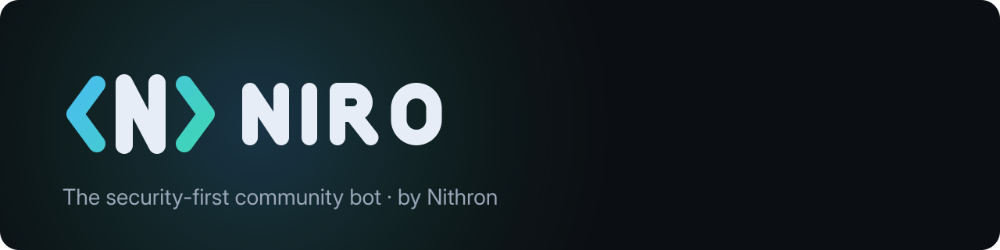

# Niro

A security-first Discord bot by [Nithron](https://nithron.com): one bot for moderation, scam and raid
protection, logging, roles, welcome and tickets, managed from a web dashboard. AI features
powered by nAI and NithronOS integration will follow.

> **Status:** building v0.1. M0 Foundations, M1 Moderation and M2 Guardian are done; M3 Logging is built and
> waiting for its demo ([M3 plan](docs/milestones/m3-plan.md)), followed by the first public release, `v0.1.0-alpha.1`.
> - [Discovery research](docs/research/2026-11-discovery.md)
> - [Go library check](docs/research/2026-11-go-library-check.md)
> - [Build plan](docs/plan.md) · [Dev setup](docs/dev-setup.md)
> - [Decisions log](docs/decisions.md)
> - [Brand assets](assets/brand/README.md)

## License

Niro's source code is available under the [Nithron Community License (NCL) v1.0](LICENSE): free for
non-commercial use. Commercial use, hosting for others, or redistributing binaries needs a commercial
license; see [COMMERCIAL.md](COMMERCIAL.md). “Niro” and its logos are trademarks of Nithron; see
[TRADEMARK_POLICY.md](TRADEMARK_POLICY.md).

Niro is not affiliated with or endorsed by Discord Inc.
