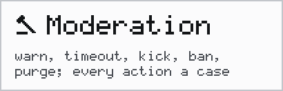
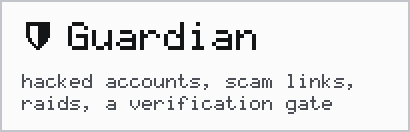
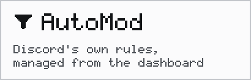
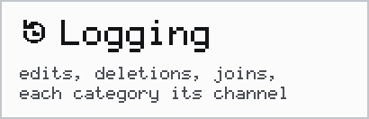
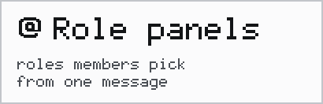
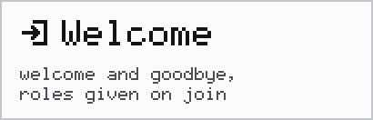
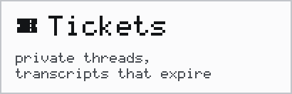
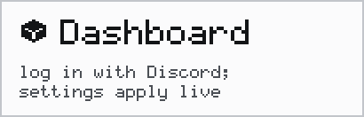

<picture><source media="(prefers-color-scheme: dark)" srcset="assets/brand/readme/hero-dark.svg"></picture>

<a href="https://niro.nithron.com">niro.nithron.com</a> · <a href="docs/user/README.md">user guide</a> · <a href="docs/self-host.md">self-host</a> · <a href="https://nithron.com">nithron.com</a>

Niro is a security-first Discord bot: moderation, protection against hacked accounts, scam links and raids, server logs, role panels, welcome messages and support tickets, set up from one web dashboard.

Niro is by [Nithron](https://nithron.com), a one-engineer studio run by Thiago Benkendorf. Client engineering is the day job. The software and the research are what it builds for itself.

Status: alpha, on the way to `v0.1.0`. Every v0.1 feature works end to end; the [build plan](docs/plan.md) shows what is left.

<picture><source media="(prefers-color-scheme: dark)" srcset="assets/brand/readme/h-what-it-does-dark.svg"></picture>

<a href="docs/user/moderation.md"><picture><source media="(prefers-color-scheme: dark)" srcset="assets/brand/readme/card-moderation-dark.svg"></picture></a> <a href="docs/user/guardian.md"><picture><source media="(prefers-color-scheme: dark)" srcset="assets/brand/readme/card-guardian-dark.svg"></picture></a>

<a href="docs/user/moderation.md"><picture><source media="(prefers-color-scheme: dark)" srcset="assets/brand/readme/card-automod-dark.svg"></picture></a> <a href="docs/user/logging.md"><picture><source media="(prefers-color-scheme: dark)" srcset="assets/brand/readme/card-logging-dark.svg"></picture></a>

<a href="docs/user/roles.md"><picture><source media="(prefers-color-scheme: dark)" srcset="assets/brand/readme/card-roles-dark.svg"></picture></a> <a href="docs/user/welcome.md"><picture><source media="(prefers-color-scheme: dark)" srcset="assets/brand/readme/card-welcome-dark.svg"></picture></a>

<a href="docs/user/tickets.md"><picture><source media="(prefers-color-scheme: dark)" srcset="assets/brand/readme/card-tickets-dark.svg"></picture></a> <a href="docs/user/getting-started.md"><picture><source media="(prefers-color-scheme: dark)" srcset="assets/brand/readme/card-dashboard-dark.svg"></picture></a>

Each module in detail

- **Moderation:** `/warn`, `/timeout`, `/kick`, `/ban` (with a confirmation step and temporary bans) and `/purge`. Every action is a numbered case in a moderation log. Discord's own AutoMod rules are managed from the dashboard.
- **Guardian:** catches hacked accounts posting the same message across channels and scam links. It quarantines the member and offers Restore, Ban or Keep for review. It also has a raid mode, `/lockdown`, a verification gate and a permission audit. Niro never opens the links people post.
- **Logging:** message edits and deletions (bulk deletions as a file), joins with the invite used, and member, moderation, server, voice, AutoMod and Guardian events, each category routed to its own channel.
- **Roles, welcome and tickets:** role panels, welcome and goodbye messages with roles given on join, and support tickets in private threads with transcripts. All of them use one shared message builder.
- **Dashboard:** log in with Discord. Every setting above applies live, with no restart.

**Privacy**

- Niro asks for the permissions it needs and never for Administrator.
- The database holds no message text, except ticket transcripts, which expire.
- A server can turn off message text in its logs.
- A server's data is deleted 30 days after Niro is removed, and its owner can delete everything at once.

Later versions in the build plan add answers drawn from a server's own documents through nAI, and alerts from nOS.

<picture><source media="(prefers-color-scheme: dark)" srcset="assets/brand/readme/h-add-niro-dark.svg"></picture>

Open the dashboard at [niro.nithron.com](https://niro.nithron.com) and log in with Discord. Pick a server where you have Manage Server and choose **Add Niro**. Then turn on the modules you want. The [user guide](docs/user/README.md) covers each module, and [getting started](docs/user/getting-started.md) covers the permissions Niro asks for and the role order.

<picture><source media="(prefers-color-scheme: dark)" srcset="assets/brand/readme/h-run-your-own-dark.svg"></picture>

The [self-host guide](docs/self-host.md) runs Niro on a Linux server with Docker Compose, HTTPS and nightly backups, under your own Discord application. It also covers running on nOS. Niro is built from source; there is no prebuilt image. A self-hosted copy carries its own name and avatar, not Niro's ([TRADEMARK_POLICY.md](TRADEMARK_POLICY.md)).

<picture><source media="(prefers-color-scheme: dark)" srcset="assets/brand/readme/h-documentation-dark.svg"></picture>

- [User guide](docs/user/README.md), [self-host guide](docs/self-host.md)
- [Build plan](docs/plan.md), [decisions](docs/decisions.md), [changelog](CHANGELOG.md)
- Operations: [runbook](docs/ops/runbook.md), [backup and restore](docs/ops/backup-restore.md), [load-test baselines](docs/ops/baselines.md)
- [Development setup](docs/dev-setup.md), [contributing](CONTRIBUTING.md)
- [Brand assets](assets/brand/README.md)

<picture><source media="(prefers-color-scheme: dark)" srcset="assets/brand/readme/h-security-dark.svg"></picture>

Do not report a vulnerability in a public issue. Use **Security, Report a vulnerability** on this repository, or write to security@nithron.com. [SECURITY.md](SECURITY.md) says what to include and what is in scope.

<picture><source media="(prefers-color-scheme: dark)" srcset="assets/brand/readme/h-licence-dark.svg"></picture>

Niro is source-available under the [Nithron Community License v1.0](LICENSE). Individuals and non-commercial communities may use it and self-host it for free. Commercial use, hosting it for others or redistributing binaries needs a commercial licence ([COMMERCIAL.md](COMMERCIAL.md)). "Niro" and its marks are trademarks of Nithron ([TRADEMARK_POLICY.md](TRADEMARK_POLICY.md)).

Niro is not affiliated with or endorsed by Discord Inc.
